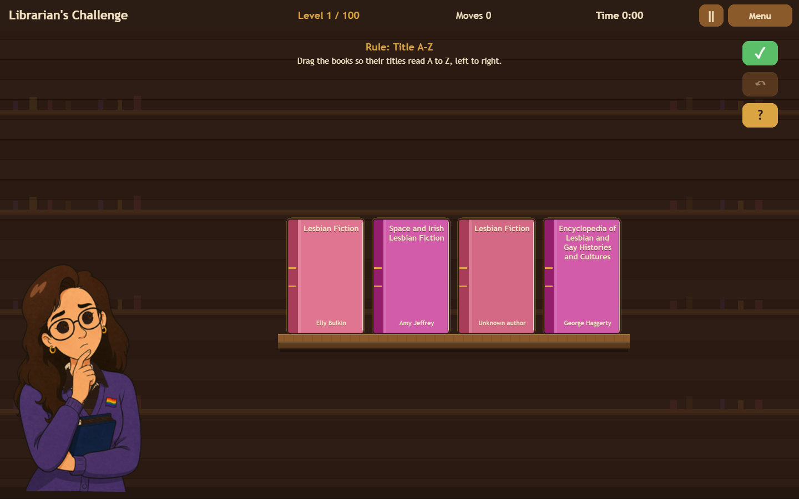
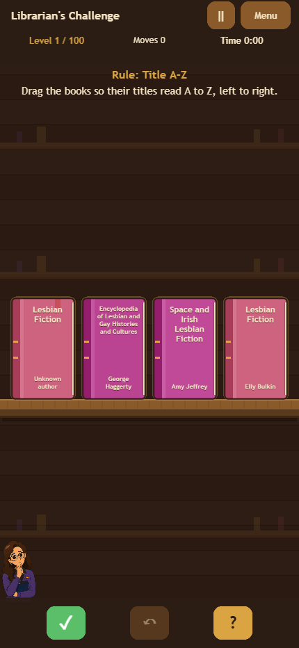

# Librarian's Challenge 👾

[](https://github.com/agustinafassina/Library.LibrarianChallenge.Game/actions/workflows/ci.yml)

A small 2D browser game built with **Phaser 3**. You play a librarian who
restores order to a messy library by sorting books on the shelves, level by
level. Each level adds a sorting rule: title, author, genre, year, or a
combination.

<p align="center">
  
  &nbsp;
  
</p>

- **100 levels**, from 4 to 67 books, spread over several shelves and up to
  three pages ([full list](LEVELS.md)).
- A catalogue of **real LGBTIQ+ and feminist books**, offline or live from the
  companion API.
- Plays with **mouse or touch**: portrait-first on phones, landscape on desktop.
- **Installable** as an app (PWA), in **English and Spanish**.

## Contents

- [Play locally](#play-locally)
- [Controls](#controls)
- [Development](#development)
- [Tests](#tests)
- [Tools](#tools)
- [Tech stack](#tech-stack)
- [More docs](#more-docs)

## Play locally

The game loads its data with `fetch()`, so it needs a static server. Opening
`index.html` directly (`file://`) won't work. From the project root:

```bash
python -m http.server 8000
# or
npx serve .
```

Then open <http://localhost:8000>. Any modern WebGL-capable browser works.

On a phone (over HTTPS or localhost) you can install it with **Add to Home
Screen** or **Install app**.

To run it in Docker, see [Configuration → Docker](docs/CONFIGURATION.md#docker).

## Controls

- **Drag and drop** a book into a slot. The other books shift to make room.
- **Check order** (✓) verifies the arrangement. It also checks automatically
  after every move. On a phone, tap an icon to see its label.
- **Hold** a book without dragging to read its full title and details.
- **R** or **Reset** restarts the level.
- Big levels span several **pages**. In landscape, use the side arrows. In
  portrait, use the small ‹ › under the shelf, or drag a book against the left
  or right edge to carry it to the next page.
- Some levels add an optional **challenge** (a move or time limit). If you go
  over it, you can retry or keep playing without the bonus.

## Development

You need **Node.js 22+** (the version CI uses).

```bash
npm install
npm run build   # writes js/runtime-config.js from .env / environment variables
```

> [!WARNING]
> `npm run build` overwrites `js/runtime-config.js` with the values from your
> `.env`, including the API key. Don't commit it: run
> `git restore js/runtime-config.js` first. CI fails if that file contains
> real values.

By default the game uses only the local catalogue in `data/books.json` and
needs no configuration. To use real books from the API, the feedback form's
reCAPTCHA, or to deploy, see **[Configuration](docs/CONFIGURATION.md)**.

Lint and formatting use [ESLint](https://eslint.org/) and
[Prettier](https://prettier.io/):

```bash
npm run lint           # report problems
npm run lint:fix       # fix what can be fixed automatically
npm run format         # format every file
npm run format:check   # check formatting without changing files
```

## Tests

**Unit tests** ([Vitest](https://vitest.dev/)) cover the sorting rules, the API
book mapper and the translations:

```bash
npm run test:unit         # run once
npm run test:unit:watch   # re-run on file changes
```

**End-to-end tests** ([Playwright](https://playwright.dev/)) open a real
browser, play through **every level** and check that each one can be solved
and that progress is saved. They start their own static server.

```bash
npm run test:install    # once: downloads Chromium
npm test                # every level (1280×800) + portrait smoke test (390×844)
npm run test:e2e        # every level, desktop only
npm run test:portrait   # menu, two levels and the Books screen at 390×844
```

The tests open the page with `?test=1`, which exposes the game as
`window.__GAME__` and enables a test-only `GameScene.autosolve()`. That helper
places the books in the expected order and triggers the win check, so the test
covers level loading, rule checks, win detection and saving. Neither hook is
active without `?test=1`.

To check the layout visually, `node tests/responsiveShot.mjs` saves screenshots
at phone, tablet and laptop sizes to `test-results/responsive/`.

**CI** ([`.github/workflows/ci.yml`](.github/workflows/ci.yml)) runs on every
push and pull request to `main`: config check, lint, format check, unit tests,
build and end-to-end tests.

## Tools

**Level designer**: previews a level before you add it to `data/levels.json`.
It prints the expected order and can write the level JSON to a draft file.

```bash
npm run level:preview -- --level 63 --title "My Level" --title_es "Mi nivel" --rule title_az --books 4,1,3,2
npm run level:preview -- --level 64 --title "Custom" --title_es "Custom" --keys genre,year:desc,title --books 3,18,4,6,1,7
```

Optional flags: `--hint`, `--hint_es`, `--challengeMoves`, `--challengeTimeSec`
and `--out data/level-draft.json`.

**Book importer**: converts a JSON file of books from the API into the game's
book shape and adds them to `data/books.json`.

```bash
node tools/import-real-books.mjs <api-books.json> [--start-id=1]
```

## Tech stack

- **Phaser 3.80.1**, vendored in `vendor/phaser.min.js`. WebGL with a Canvas
  fallback, and `Scale.RESIZE` so the game fills the viewport.
- **Vanilla JavaScript (ES modules)**, HTML and CSS. No framework or bundler:
  it runs from any static server.
- **localStorage** for progress, scores and language. **Web Audio** for sound.
- **PWA**: `manifest.json` + service worker (`sw.js`).
- **Formspree** for the feedback form, with optional reCAPTCHA v3.
- Optional book data from
  [Library.LibrarianChallenge.Game.Api](https://github.com/agustinafassina/Library.LibrarianChallenge.Game.Api).

## More docs

- [Configuration and deployment](docs/CONFIGURATION.md): environment variables,
  API, reCAPTCHA, versioning, Docker and the production checklist.
- [How it works](docs/ARCHITECTURE.md): project layout, data loading, sorting
  rules, saving, languages, art and audio.
- [Levels](LEVELS.md): books, shelves and pages for every level.
